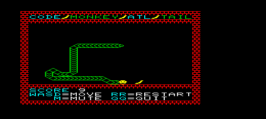

# MonkeyTail

MonkeyTail is a snake game for the **unexpanded VIC-20**, written in Commodore BASIC V2. A monkey eats bananas, and its tail grows behind it.

## features (planned)

- a monkey whose tail grows with every banana
- the tail drawn with custom characters: chevrons that show which way it's moving, and a tapered tip
- walls end the game
- runs on a stock VIC-20 with no memory expansion

## how to play

Steer the monkey to the bananas. Hitting a wall or your own tail ends the game. Controls aren't decided yet.

## screenshots



## compatibility

- Unexpanded VIC-20 (3583 bytes free for BASIC). Not yet tested with RAM expansion.
- Tested in VICE 3.10 (xvic).

## repository layout

```
src/
  monkeytail.bas     the game

prgs/
  (.prg files built by the GitHub Action)

docs/
  design.md          how the program works: data model, routines, variables, memory
  todo.md            known issues and ideas

screenshots/
  images used in this README (temp/ holds working captures and is gitignored)

tools/
  petcat, petcat.exe   petcat for Linux (CI) and Windows (local builds)
  c1541, c1541.exe     c1541 for making disk images

buildtools/
  build-and-run.ps1  local build: check, petcat the current .bas, then autostart it in VICE
  check-basic.ps1    lint a .bas file against the coding guidelines (warnings only)
  strip-rems.ps1     copy a .bas file without its rems, for the build
  basic-tokens.ps1   the BASIC V2 tokenizer that check-basic and strip-rems share
  machine.ps1        the machines the tools know (VIC-20, C64): emulator, load address, line limit
  screenshot.ps1     save the running emulator's screen to screenshots/temp/ (gitignored)
  keys.ps1           type keys into the running emulator (for testing)
  tasks.vs.json      Visual Studio task (copy to .vs/tasks.vs.json)
  tasks.json         VS Code task (copy to .vscode/tasks.json)

.github/workflows/
  build-prg.yml      builds .prg files when a pull request is merged
```

## building

The `.prg` is generated with `petcat`. The repository includes Linux and Windows versions in `tools/`.

**The `rem`s are stripped first.** They cost memory on the VIC, so the source keeps them and the PRG doesn't: `buildtools/strip-rems.ps1` writes a copy without them (a line that's only a `rem` is dropped, a `:rem` at the end of a line is cut off), and petcat builds that copy. So put a routine's `rem` at the end of its first code line, never on a line of its own that a `goto` or `gosub` jumps to (`check-basic.ps1` warns about that). By hand, without stripping:

```
petcat -w2 -l 1001 -o prgs/monkeytail src/monkeytail.bas
```

`-l 1001` sets the load address to $1001, the start of BASIC on an unexpanded VIC-20.

### build and run from the IDE

`buildtools/build-and-run.ps1` checks the open `.bas` file with `check-basic.ps1`, builds it into `prgs/` and autostarts it in xvic. The check prints warnings (missing jump targets, lines too long to edit on the VIC, stray spaces, line-number problems, keywords formed across a variable name and the next word) but never stops the build. If xvic is already running with its remote monitor on port 6510, the program is sent to that window; otherwise a new xvic is started with `-remotemonitor`. `petcat.exe` and `xvic.exe` must be on your `PATH`.

A file named `<name>-c64.bas` is built for the Commodore 64 instead (load address $0801) and runs in x64sc, whose monitor uses port 6511, so a VIC-20 and a C64 can run side by side.

The IDE config folders are gitignored, so copy the task file into place once:

- Visual Studio (Open Folder): copy `buildtools/tasks.vs.json` to `.vs/tasks.vs.json`, then Build with a `.bas` file active.
- VS Code: copy `buildtools/tasks.json` to `.vscode/tasks.json`, then run the default build task.

## running

### in VICE

```
xvic -memory none -autostart prgs/monkeytail
```

or load it from the BASIC prompt:

```
load "monkeytail",8
run
```

### on real hardware

Copy the PRG to a disk image or transfer it with your preferred method (SD2IEC, Pi1541, etc.). No RAM expansion is needed.

## automatic build

When a pull request that changes any `.bas` file is merged (or a `v*` tag is pushed), the GitHub Action in `.github/workflows/build-prg.yml`:

- strips the `rem`s from each changed `.bas` file (`buildtools/strip-rems.ps1`, run with `pwsh`) and runs the repository's `tools/petcat` on the result, as the local build does
- writes the resulting `.prg` files to `prgs/`
- commits them to `main`, naming the pull request or tag in the commit message
- when a pull request deletes or renames a `.bas` file, removes that file's old `.prg` from `prgs/` in the same commit

This keeps the PRGs in sync with the BASIC source without installing the full VICE package.

## license

This project is released under the MIT License. See the `LICENSE` file for details.
